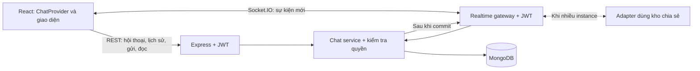

# Kế hoạch phát triển chat cho Task Manager

Ngày lập: 21/10/2026. Phạm vi người dùng xác nhận: chat giữa thành viên và chat theo task.

Đây là kế hoạch triển khai, chưa phải tính năng đã được xây dựng. Các quy tắc sản phẩm dưới đây là đề xuất mặc định để có thể bắt đầu thiết kế và chia công việc.

## 1. Kết quả đọc dự án

| Hiện trạng trong mã nguồn | Ý nghĩa đối với tính năng chat |
| --- | --- |
| `backend/server.js`: Express, mount REST routes; export app để test; chỉ listen ngoài test/Vercel | Cần tách khởi tạo app và HTTP/Socket.IO server, giữ khả năng test API độc lập |
| `backend/models/User.js`, `middlewares/authMiddleware.js`: MongoDB, JWT, role admin/user | Tái sử dụng danh tính và quy tắc xác thực; bổ sung middleware cho socket |
| `backend/models/Task.js`: `createdBy`, `assignedTo[]` | Đã có dữ liệu để xác định người tham gia phòng task |
| `backend/controllers/taskController.js:getTaskById` | Admin, người tạo và người được giao được xem task; đề xuất dùng cùng quyền cho chat task |
| `backend/controllers/userController.js:deleteUser` | Xóa cứng user và xóa hàng loạt task do user tạo; cần xử lý vòng đời chat cả ở đường đi này |
| `backend/utils/teamMembersSummary.js` | Team Members chỉ gồm người có task chung; chưa phải danh bạ toàn hệ thống |
| `backend/models/Notification.js`, `components/layouts/NotificationDropdown.jsx` | Có thông báo, hiện frontend tải lại mỗi 3 giây; chưa có realtime |
| `backend/routes/uploadRoutes.js`, `middlewares/uploadMiddleware.js` | Có upload ảnh JPG/PNG tối đa 5 MB lên Cloudinary; chưa có upload tài liệu hoặc cơ chế ảnh riêng tư cho chat |
| `frontend/Task-Manager/src/App.jsx`, `context/userContext.jsx` | Route tách admin/user; user/token có sẵn; provider chat nên tồn tại qua chuyển trang |
| `components/team/TeamMembersView.jsx`, `components/tasks/TaskDetailsPage.jsx` | Có vị trí phù hợp cho nút nhắn tin và khung thảo luận task |
| `backend/vercel.json`, `frontend/Task-Manager/vercel.json` | Có cấu hình Vercel trong repo; chưa xác minh môi trường đang chạy thực tế |
| `tests/backend-tests`, `frontend/Task-Manager/src/tests` | Có Vitest, Supertest, MongoDB Memory Server và React Testing Library để mở rộng |

Không thấy model hội thoại/tin nhắn hay dependency Socket.IO trong phần mã và manifest đã đọc. Working tree đang có thay đổi liên quan test; khi triển khai cần giữ các thay đổi đó và đo baseline trước.

## 2. Phạm vi sản phẩm

### Bản đầu tiên: chat văn bản hoàn chỉnh

- Chat 1–1 giữa hai tài khoản đang tồn tại; mỗi cặp có đúng một hội thoại.
- Chat nhóm theo task: mỗi task có tối đa một hội thoại, tạo khi mở lần đầu.
- Danh sách hội thoại có tin cuối, thời gian và số tin chưa đọc; lọc Cá nhân / Công việc.
- Gửi và nhận tin thời gian thực; tải lịch sử theo trang, 30 tin/lần, tối đa 100.
- Giao diện trạng thái đang gửi / đã lưu trên server / gửi thất bại, cho phép thử lại.
- Tải lại tin bị lỡ sau mất mạng, refresh hoặc đổi thiết bị; chống hiển thị và lưu trùng.
- Đánh dấu đã đọc, đồng bộ số chưa đọc giữa các tab/thiết bị.
- Responsive, dark mode, trạng thái tải/rỗng/lỗi và điều hướng bằng bàn phím.

### Phần mở rộng sau khi bản đầu ổn định

- Đang nhập, online/offline với thời hạn tự hết; online khi còn ít nhất một kết nối.
- Ảnh đính kèm qua endpoint có kiểm tra quyền hội thoại và cơ chế truy cập ảnh phù hợp.
- Trả lời tin, mention, tìm nội dung, sửa/thu hồi tin, nhóm tự tạo.
- Gọi thoại/video, chatbot AI và push khi đóng ứng dụng là các hạng mục riêng.

## 3. Quy tắc quyền truy cập và vòng đời

| Tình huống | Hành vi đề xuất |
| --- | --- |
| Chat 1–1 | Chỉ hai người tham gia được đọc/gửi; admin không được đọc chỉ nhờ role |
| Bắt đầu chat | Cho phép với tài khoản khác còn tồn tại; Team Members là lối tắt, danh bạ chat là endpoint phân trang riêng |
| Chat task | Người tạo, người đang được giao và admin được mở, xem lịch sử, gửi tin; giao diện hiển thị rõ admin có quyền truy cập |
| Admin mở chat task | Ghi nhận người đã tham gia để quản lý trạng thái đọc; không tự đăng ký tất cả admin vào mọi phòng |
| Task thêm người | Người mới được xem toàn bộ lịch sử task; trạng thái đọc ban đầu là chưa đọc các tin của người khác |
| Task bỏ người | Thu hồi quyền ngay sau cập nhật: không đọc, gửi hay nhận nội dung mới, trừ khi vẫn là người tạo hoặc admin |
| Thay đổi role admin | Tính lại quyền task cho các kết nối liên quan; không chỉ kiểm tra role ở lúc kết nối |
| Task hoàn thành | Vẫn cho trao đổi, không tự khóa phòng |
| Task bị xóa | Phòng task ngừng xuất hiện và từ chối truy cập; giữ dữ liệu đã lưu để tránh mất lịch sử do cascade, chưa tự đặt thời hạn xóa |
| User bị xóa | Ngắt mọi socket của user; giữ tin cũ với nhãn “Tài khoản đã xóa”; hội thoại 1–1 còn lại chỉ đọc |
| Xóa user làm xóa task | Thu hồi quyền/đóng chat của tất cả task bị ảnh hưởng, kể cả task bị xóa bằng `deleteMany` |
| Task đổi tên | Hiển thị tên hiện tại, không tạo phòng mới |

Quyền chat task phải lấy từ Task và User hiện tại. Bản ghi tham gia hội thoại và việc đã join socket room không đủ để chứng minh quyền. Áp dụng cùng một policy ở REST, subscribe, phát nội dung và mọi thao tác ghi. Khi mất quyền, client xóa dữ liệu hội thoại khỏi state/cache.

## 4. Kiến trúc đề xuất

Giữ React + Express + Mongoose. Thêm `socket.io` ở backend và `socket.io-client` ở frontend; chưa cần dịch vụ chat riêng.



- REST là đường ghi duy nhất ở bản đầu: dễ kiểm thử, kiểm tra quyền và thử lại. Socket dùng để nhận sự kiện; không tạo thêm một luồng gửi tin độc lập.
- MongoDB là nguồn dữ liệu chuẩn. Socket lỗi không làm mất bản tin đã lưu; client đồng bộ lại qua REST.
- `ChatProvider` nằm bên trong `UserProvider`, tồn tại qua các route; không đặt kết nối trong `DashboardLayout` vì layout được dựng lại ở mỗi trang.
- Dùng room `user:<id>` do server gán từ JWT để đồng bộ mọi thiết bị; chỉ phát nội dung đến người còn quyền. Các đăng ký theo hội thoại phải được kiểm tra và thu hồi khi quyền đổi.
- JWT qua `handshake.auth.token`, kiểm tra token và user ở server. Socket bị ngắt khi token hết hạn, logout hoặc user bị xóa; kiểm tra lại quyền khi thao tác.
- Origin của socket và REST phải được giới hạn theo môi trường; giới hạn tốc độ gửi, mở hội thoại và subscribe; giới hạn payload.

Socket.IO mặc định không đảm bảo tự phát lại mọi sự kiện bị lỡ, nên reconnect phải lấy lại dữ liệu đã lưu. Xem [delivery guarantees](https://socket.io/docs/v4/delivery-guarantees/) và [socket middleware](https://socket.io/docs/v4/middlewares/).

### Triển khai với cấu hình Vercel hiện có

Tài liệu Vercel hiện tại hỗ trợ Socket.IO qua WebSocket trực tiếp; kết nối có thể bị đóng khi hết thời lượng Function và các lần kết nối có thể vào instance khác. Vì vậy cần kiểm chứng đường dẫn socket, cấu hình transport, reconnect và adapter chia sẻ trước khi chọn cấu hình production. Xem [Vercel WebSockets](https://vercel.com/docs/functions/websockets).

- Bước đầu: thử trên preview nếu có quyền/môi trường deploy. Dùng `transports: ['websocket']` và path thống nhất; kiểm tra config `builds/routes` hiện tại có cần cập nhật.
- Nếu production dùng nhiều Function/instance: phải có adapter phát sự kiện giữa instance ngay từ đầu; không chờ đến khi lượng người dùng lớn. Bản ghi MongoDB vẫn lưu toàn bộ lịch sử.
- Nếu chọn Node chạy liên tục một instance: có thể bắt đầu không dùng adapter; thêm adapter trước khi nhân bản backend. Đây là phương án thay thế khi spike Vercel không đáp ứng nhu cầu vận hành.
- Redis Pub/Sub adapter không thay thế lưu tin và không hỗ trợ Socket.IO connection state recovery; thiết kế đồng bộ bằng REST vẫn cần thiết. Xem [Redis adapter](https://socket.io/docs/v4/redis-adapter/) và [multiple nodes](https://socket.io/docs/v4/using-multiple-nodes/).
- Không thay hosting, tạo tài nguyên trả phí hoặc deploy production trong phạm vi lập kế hoạch này.

## 5. Thiết kế dữ liệu

Thêm ba collection; không nhúng lịch sử tin nhắn vào Task/User.

| Model | Trường chính | Index/ràng buộc |
| --- | --- | --- |
| `Conversation` | `type: direct/task`, `directKey`, `directParticipants`, `taskId`, `lastMessageId`, `lastMessageSeq`, `lastMessageAt`, `archivedAt`, timestamps | Unique partial index cho `directKey` khi type=direct; unique partial index cho `taskId` khi type=task |
| `Message` | `conversationId`, `senderId`, `clientMessageId`, `sequence`, `type: text`, `text`, timestamps | Unique `(conversationId, sequence)`; unique `(conversationId, senderId, clientMessageId)` |
| `ConversationMember` | `conversationId`, `userId`, `lastReadSequence`, `joinedAt`, `revokedAt` | Unique `(conversationId, userId)`; index `(userId, revokedAt, conversationId)` |

- `directKey` là hai user ID sắp xếp rồi ghép ở server; tạo bằng upsert và xử lý duplicate-key để tránh hai phòng khi cùng nhấn nhắn tin.
- Với task, quyền vẫn được suy ra từ task/role hiện tại; member lưu trạng thái tham gia/đọc và người nhận thông báo, không thay thế policy.
- `clientMessageId` do client tạo một lần và giữ nguyên khi retry. Server lấy `senderId` từ JWT, không nhận từ body.
- Tin văn bản trim, từ 1 đến 4.000 ký tự; render text bình thường, không render HTML trực tiếp.
- Gửi tin dùng MongoDB transaction: kiểm tra quyền, cấp sequence tăng dần cho hội thoại, lưu Message và cập nhật tin cuối. Chỉ phản hồi thành công/phát sự kiện sau commit. Retry cùng ID trả lại tin đã lưu.
- Transaction yêu cầu MongoDB replica set; cần xác minh môi trường thật và dùng `MongoMemoryReplSet` cho test chat thay vì MongoMemoryServer standalone hiện tại.
- Số chưa đọc được tính từ tin có `sequence > lastReadSequence` và người gửi khác user. Bản đầu chưa lưu counter riêng để giảm rủi ro sai lệch.
- Đánh dấu đọc bằng sequence của tin thực tế mà client đã hiển thị. Server xác minh tin thuộc phòng và chỉ tăng watermark bằng `$max`; không nhận thời gian đọc tùy ý từ client.
- Phân trang lịch sử theo sequence, không dùng offset lớn. Danh sách hội thoại có cursor `(lastMessageAt, _id)` và index hỗ trợ; truy vấn theo user tránh N+1.

## 6. API và sự kiện

Tất cả API yêu cầu `protect` và kiểm tra quyền hội thoại.

| Endpoint đề xuất | Chức năng |
| --- | --- |
| `GET /api/chat/users?search=&cursor=&limit=` | Tìm người để bắt đầu chat; chỉ trả ID, tên, ảnh và role cần thiết |
| `POST /api/chat/conversations/direct` | Body `{ userId }`; tạo hoặc trả hội thoại 1–1 có sẵn |
| `POST /api/chat/tasks/:taskId/conversation` | Tạo hoặc trả hội thoại task sau khi kiểm tra quyền |
| `GET /api/chat/conversations?type=&cursor=&limit=` | Danh sách người dùng đã tham gia và còn quyền, tin cuối, unread và tổng unread |
| `GET /api/chat/conversations/:id` | Metadata và quyền hiện tại; hỗ trợ mở từ link trực tiếp |
| `GET /api/chat/conversations/:id/messages?before=&limit=` | Tải trang cũ; trả cursor/hasMore |
| `GET /api/chat/conversations/:id/messages?after=&limit=` | Đồng bộ tin bị lỡ; lặp phân trang tới khi bắt kịp |
| `POST /api/chat/conversations/:id/messages` | Body `{ clientMessageId, text }`; lưu tin idempotent |
| `PUT /api/chat/conversations/:id/read` | Body `{ lastReadSequence }`; cập nhật watermark của chính user |

Đề xuất mã lỗi: 400 dữ liệu không hợp lệ, 401 chưa xác thực, 403 không có quyền, 404 tài nguyên không tồn tại, 409 hội thoại đã đóng, 429 quá giới hạn.

Sự kiện server → client:

- `message:new`: tin đã lưu, ID, sequence và clientMessageId để merge với optimistic message.
- `conversation:updated`: yêu cầu cập nhật metadata, tin cuối và số chưa đọc qua REST.
- `conversation:read`: đồng bộ watermark giữa các thiết bị; đọc bởi người khác có thể hiển thị sau.
- `conversation:access-revoked`: xóa hội thoại khỏi UI/cache và chặn gửi.

Không coi event là nguồn dữ liệu duy nhất. Sau reconnect, focus lại tab và định kỳ khi tab đang hoạt động, client kiểm tra thay đổi bằng REST; điều này xử lý cả trường hợp server đã commit nhưng lỗi trước khi emit. Nếu cần đảm bảo phát sự kiện kể cả qua crash mà không chờ đối soát, bổ sung transactional outbox ở giai đoạn nâng cao.

## 7. Tích hợp giao diện và file dự kiến

- Thêm `/admin/chat` và `/user/chat`, hỗ trợ `?conversation=<id>` để mở trực tiếp; hai route dùng chung một trang.
- Menu “Chat” có badge tổng chưa đọc; desktop gồm danh sách bên trái và hội thoại bên phải, mobile chuyển giữa hai màn hình.
- Thêm nút “Nhắn tin” ở `TeamMembersView.jsx` và nút tạo chat từ danh bạ trong trang Chat.
- Thêm phần “Thảo luận” trong `TaskDetailsPage.jsx`; dùng chung `ConversationPanel` với trang Chat và có link mở toàn màn hình.
- Chỉ tự cuộn nếu đang gần cuối hoặc chính mình gửi. Khi đọc tin cũ, hiện nút có tin mới; tải thêm phía trên phải giữ vị trí cuộn.
- Chỉ đánh dấu đọc khi hội thoại đang mở, tab hiển thị và tin đã được xem. Tin tự gửi không làm tăng unread.
- Khi gửi thất bại giữ nội dung/ID để retry; không báo đã giao/đã đọc chỉ vì REST trả thành công.
- Badge chat là nguồn thông báo chính của MVP. Chưa tạo một Notification cho từng tin, tránh làm tràn dropdown hiện tại vốn chỉ lấy 50 bản ghi.

```text
backend/
  app.js                              # Express app dùng lại cho test/server
  server.js                           # bootstrap HTTP và Socket.IO
  models/{Conversation,Message,ConversationMember}.js
  controllers/chatController.js
  routes/chatRoutes.js
  services/{chatService,chatAccessService}.js
  realtime/{socketServer,socketAuth}.js

frontend/Task-Manager/src/
  pages/Chat/ChatPage.jsx
  components/chat/{ConversationList,ConversationPanel,MessageList,MessageComposer,NewChatDialog}.jsx
  context/chatContext.jsx
  hooks/useConversation.js
  utils/{chatApi,socketClient}.js

tests/backend-tests/{chat,chat-socket}.test.js
frontend/Task-Manager/src/tests/components/chat/
frontend/Task-Manager/src/tests/context/chatContext.test.jsx
```

File cần sửa: `App.jsx`, `utils/apiPaths.js`, `utils/data.js`, `SideMenu.jsx`, `TeamMembersView.jsx`, `TaskDetailsPage.jsx`, backend task/user controllers, package manifests và env example. `Notification`/dropdown chỉ cần sửa khi thêm thông báo chat nâng cao.

Khi tách app/server, cập nhật helper test đang tự mount route để dùng chung app factory hoặc bổ sung route chat nhất quán; không để test chỉ chạy một bản app khác production.

## 8. Thứ tự triển khai và mốc hoàn thành

Ước lượng dưới đây dành cho một lập trình viên quen dự án, chưa gồm chờ cấu hình hạ tầng hoặc thay đổi yêu cầu. Các giai đoạn thực hiện tuần tự theo phụ thuộc.

| Giai đoạn | Công việc | Đầu ra có thể nghiệm thu | Ước lượng |
| --- | --- | --- | --- |
| 0 | Đo baseline test/build; chốt policy; xác minh MongoDB replica set; spike Vercel/Socket.IO và adapter | Quyết định môi trường, hai client nhận được sự kiện và reconnect thành công | 0,5–1 ngày |
| 1 | Model, index, quyền truy cập, API hội thoại/tin nhắn/đọc và test tích hợp | Gửi và đọc được qua REST; không tạo phòng/tin trùng; chặn truy cập trái quyền | 2–3 ngày |
| 2 | Socket auth, user rooms, emit sau commit, reconnect và đồng bộ | Hai tài khoản nhận tin, nhiều tab nhất quán, mất mạng không mất tin đã lưu | 1–2 ngày |
| 3 | ChatPage, provider, composer, lịch sử, optimistic UI, badge và Team Members | Chat 1–1 dùng được trên desktop/mobile | 2–3 ngày |
| 4 | Khung chat task; đồng bộ giao việc, role, xóa task/user | Chat task tuân theo quyền hiện tại trên mọi kết nối | 1–2 ngày |
| 5 | Kiểm thử xuyên luồng, giới hạn tải, staging, log lỗi và tài liệu vận hành | Bản MVP đạt checklist, sẵn sàng xem xét phát hành | 1–2 ngày |

Tổng dự kiến: **7,5–13 ngày làm việc** cho chat văn bản 1–1 và theo task. Ảnh đính kèm cùng typing/presence dự kiến thêm 2–4 ngày, cần xem lại sau khi chốt quyền truy cập file.

## 9. Checklist kiểm thử và nghiệm thu

### Backend và realtime

- Hai request cùng tạo chat 1–1/task vẫn chỉ có một hội thoại.
- Retry cùng clientMessageId, kể cả sau timeout, chỉ lưu một tin; sequence và tin cuối nhất quán.
- Người ngoài phòng không xem, gửi, đọc hay đăng ký nhận tin; admin không đọc được DM của người khác.
- User bị bỏ khỏi task không nhận nội dung mới trên socket đã mở; kiểm tra cả tab thứ hai và instance khác.
- Giảm role admin, xóa user, xóa task trực tiếp và xóa task qua deleteUser đều thu hồi quyền đúng.
- Token sai/hết hạn, user không còn tồn tại và quá giới hạn gửi đều được xử lý rõ.
- Hai người gửi đồng thời, phân trang trước/sau và đọc từ nhiều thiết bị không mất/trùng tin; watermark không lùi.
- Mất kết nối giữa commit và response/emit, restart backend và reconnect sang instance khác đều khôi phục được bằng REST.

### Frontend và trải nghiệm thực tế

- Mở chat từ Team Members, menu, task details và link trực tiếp đều đến đúng phòng.
- Đổi route không tạo thêm kết nối/listener; kiểm tra mount/cleanup trong React StrictMode hiện có.
- Người dùng xem được trạng thái gửi lỗi và retry; nội dung HTML/script chỉ hiển thị như văn bản.
- Badge không tăng vì tin tự gửi; xem phòng khác/tab nền không tự đánh dấu đọc.
- Tải lịch sử giữ vị trí cuộn; tin mới không kéo người dùng khỏi đoạn đang đọc.
- Thử thủ công hai tài khoản, hai tab, offline/online, mobile và dark mode.

Chạy kiểm tra hiện có từ đúng thư mục, sau khi ghi nhận baseline:

```text
tests:                         npm run test:backend
frontend/Task-Manager:          npm test
frontend/Task-Manager:          npm run build
frontend/Task-Manager:          npm run lint
```

Không mặc định các script đang pass: kế hoạch này mới đọc mã nguồn, chưa chạy suite hoặc thử deploy. Khi triển khai, phân biệt lỗi có sẵn với lỗi do tính năng chat.

## 10. Các quyết định cần kiểm chứng khi bắt đầu

1. Backend production thực tế có dùng Vercel không; path Socket.IO, timeout, adapter chia sẻ và môi trường preview hoạt động thế nào.
2. MongoDB có hỗ trợ transaction; cần chuẩn bị replica set cho local/test chat.
3. Người mới được giao task xem toàn bộ lịch sử và admin có quyền xem chat task là chính sách mặc định được đề xuất, cần thể hiện rõ trong UX/tài liệu sản phẩm.
4. Ước lượng số người dùng đồng thời, kích thước lịch sử và thời hạn lưu trữ để chọn giới hạn vận hành; chưa có số liệu trong repo.
5. Với ảnh ở giai đoạn sau: URL Cloudinary hiện tại là URL công khai; phải thiết kế kiểm soát truy cập nếu muốn ảnh chỉ dành cho thành viên hội thoại.

Ưu tiên bắt đầu từ nền tảng dữ liệu/quyền và API, sau đó hoàn thiện chat 1–1 trước khi tích hợp đầy đủ vòng đời task.
